<p align="center"></p>

<h1 align="center">VectorRF Lab</h1>

<p align="center">A local, browser-based workbench for RF signals and DSP: design complex-baseband signals or open I/Q recordings, and look at them with a spectrum analyzer, a receiver, a classifier and a radar simulator — up to 5 GS/s, without radio hardware.</p>

<p align="center">
  <a href="https://github.com/BehradTabatabaee/vectorrf-lab/actions/workflows/ci.yml"></a>
  
  <a href="LICENSE"></a>
</p>

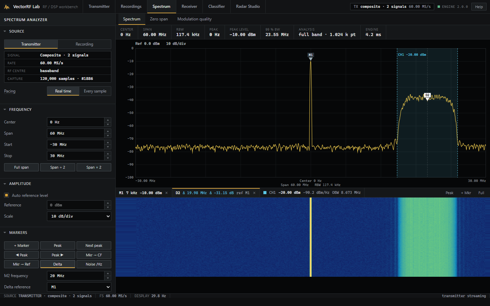

VectorRF Lab is written in Python (FastAPI, NumPy, SciPy) with a dependency-free browser interface. It is meant for learning, prototyping and algorithm experiments. It is **not** a calibrated instrument, a standards-conformance tool, a hardware SDR driver or an electromagnetic solver; [what it does not do](#what-it-does-not-do) lists the limits.

## Highlights

- **Transmitter**: analog, PSK/QAM/APSK, FSK/MSK/GMSK, OFDM, chirps, radar codes and custom waveforms; **composites** of up to 16 signals, each at its own power and frequency; **frequency hopping and sweeps** on any signal with exact 64-bit DDS phase.
- **Spectrum analyzer**: centre/span with digital down-conversion, mouse zoom, normal/delta/noise markers, draggable channel-power windows, four traces, waterfall, zero span and modulation quality.
- **Receiver**: acquires carrier offsets up to ±10 % of the symbol rate, tracks timing and carrier across captures, CMA equalization with a channel estimate, de-hopping, generic framing, OFDM and an editable processing chain.
- **Classifier** that shows its reasoning: every rule, measured feature, threshold and outcome.
- **I/Q recordings**: raw, WAV/RF64 and SigMF files, memory-mapped, as the live source for every instrument; export to SigMF, WAV or raw.
- **Radar Studio**: waveform designer, interactive scene, arrays and beamforming, range–Doppler processing and CA-, GO-, SO- and OS-CFAR detection.
- One deterministic sample stream: every view of a capture sees the same samples, and consecutive captures join seamlessly.

## Quick start

With Python 3.10 or newer:

```bash
bash start.sh        # Linux / macOS
```

```bat
start.bat            :: Windows
```

The script creates `.venv`, installs the package and serves the lab at **http://127.0.0.1:8765** (`VECTORRF_PORT` changes the port). The transmitter starts with a 50 kBd QPSK carrying a PN15 sequence: open **Spectrum**, **Receiver** or **Classifier** to look at it. The in-app **Help** page (`/help`) is the user guide.

Or install it yourself:

```bash
python -m venv .venv
source .venv/bin/activate            # Windows: .venv\Scripts\activate
python -m pip install -e .
vectorrf-lab                         # VECTORRF_HOST and VECTORRF_PORT override the address
```

## Interface tour

<table>
  <tr>
    <td width="50%"><strong>Transmitter · a composite of two signals</strong><br>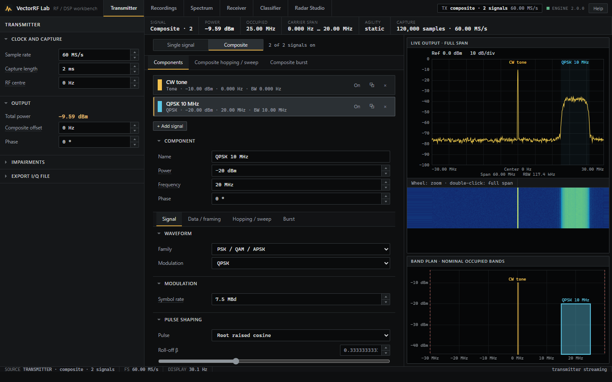</td>
    <td width="50%"><strong>Transmitter · hopping 900 MHz – 1 GHz</strong><br>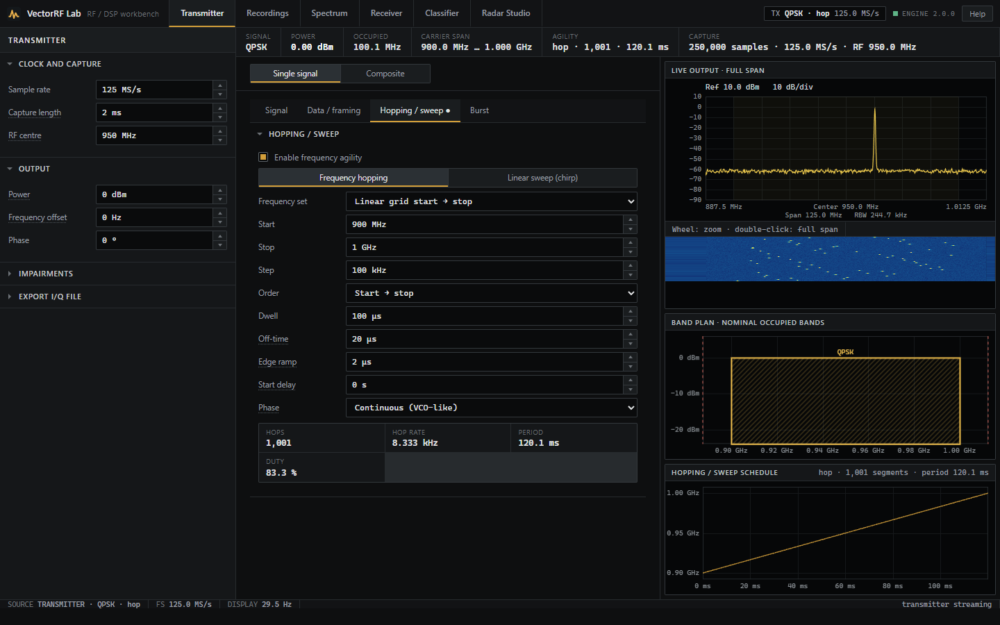</td>
  </tr>
  <tr>
    <td width="50%"><strong>Recordings · the hopping signal exported and re-opened</strong><br>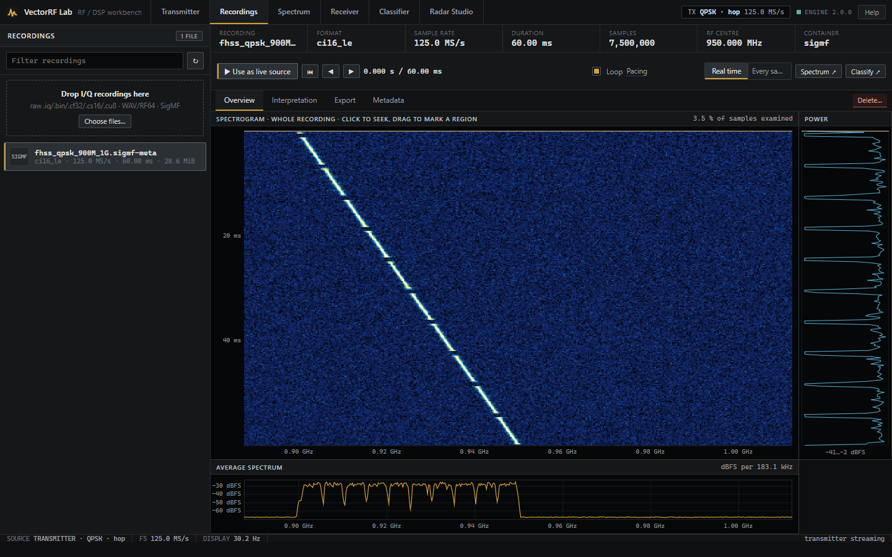</td>
    <td width="50%"><strong>Receiver · demodulation</strong><br>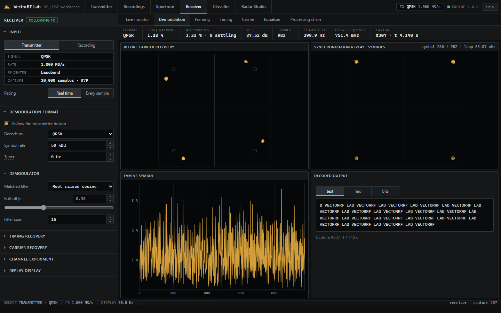</td>
  </tr>
  <tr>
    <td width="50%"><strong>Receiver · an echo and the CMA equalizer</strong><br>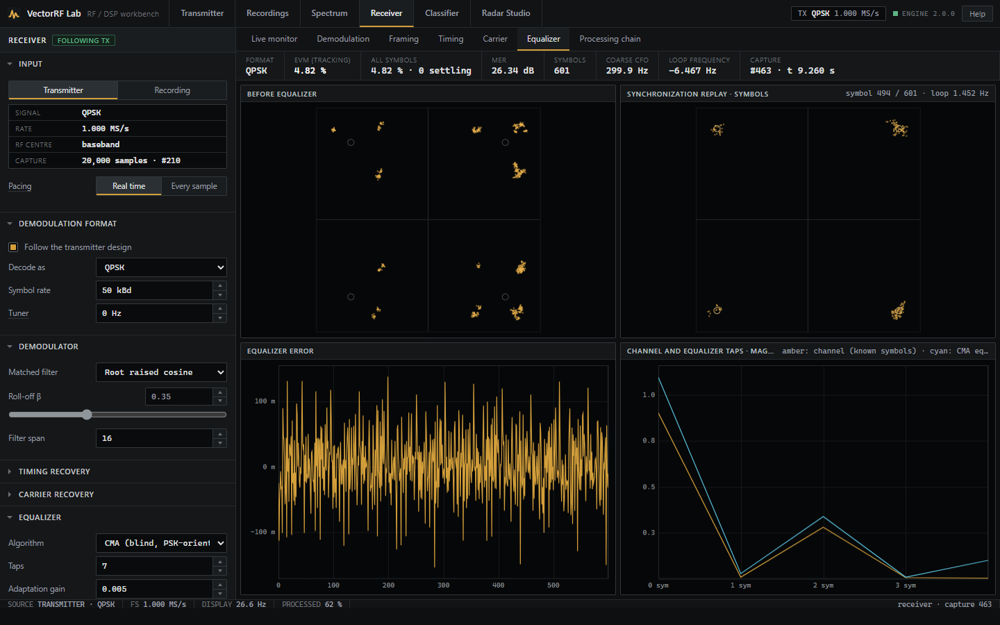</td>
    <td width="50%"><strong>Spectrum · modulation quality of 16-QAM</strong><br>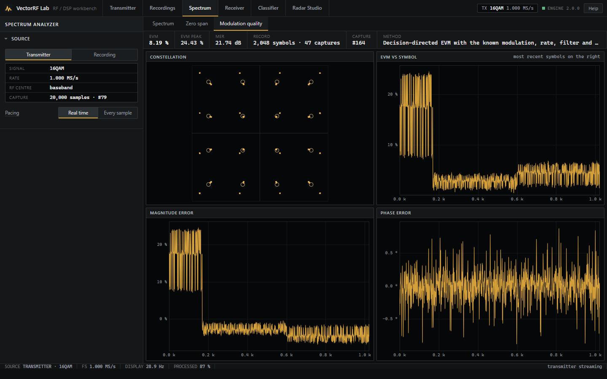</td>
  </tr>
  <tr>
    <td width="50%"><strong>Classifier · decision path</strong><br>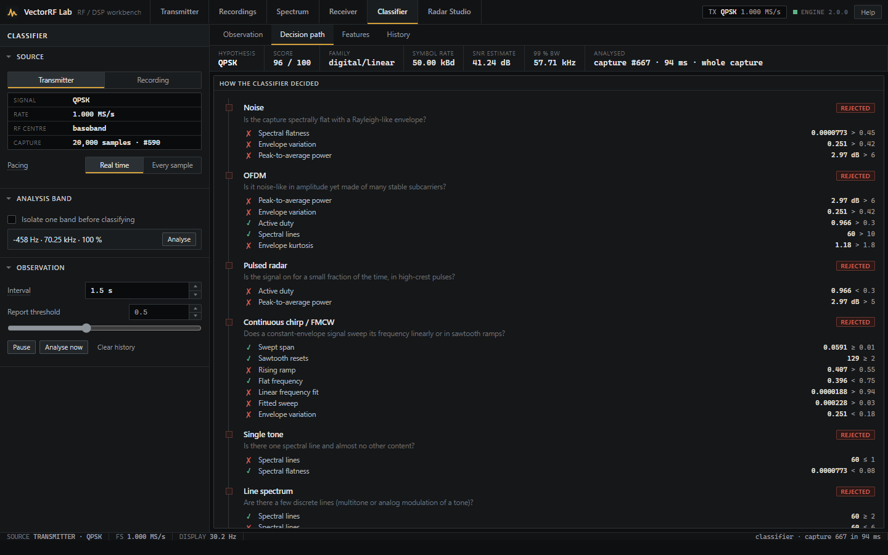</td>
    <td width="50%"><strong>Radar Studio · interactive scene</strong><br>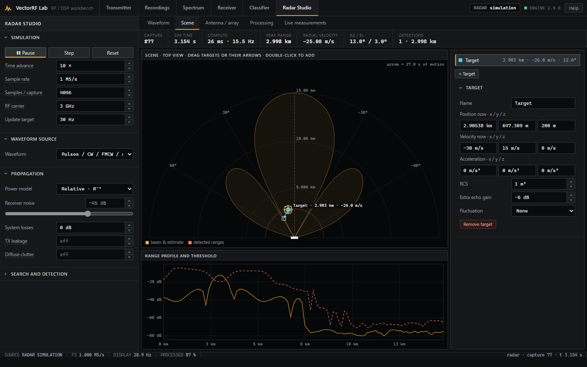</td>
  </tr>
  <tr>
    <td width="50%"><strong>Radar Studio · OS-CFAR detection</strong><br>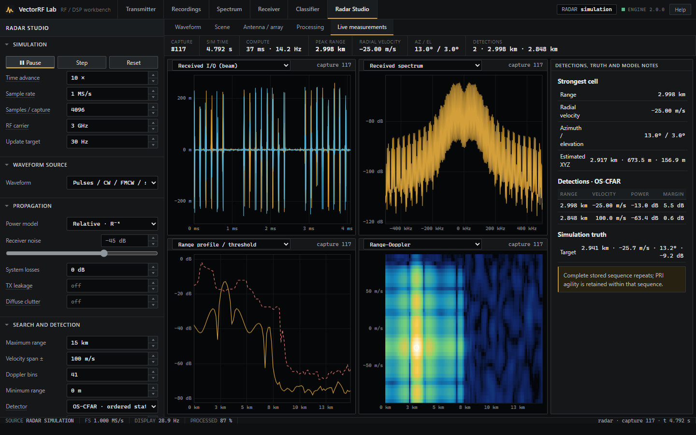</td>
    <td width="50%"><strong>Radar Studio · waveform designer</strong><br>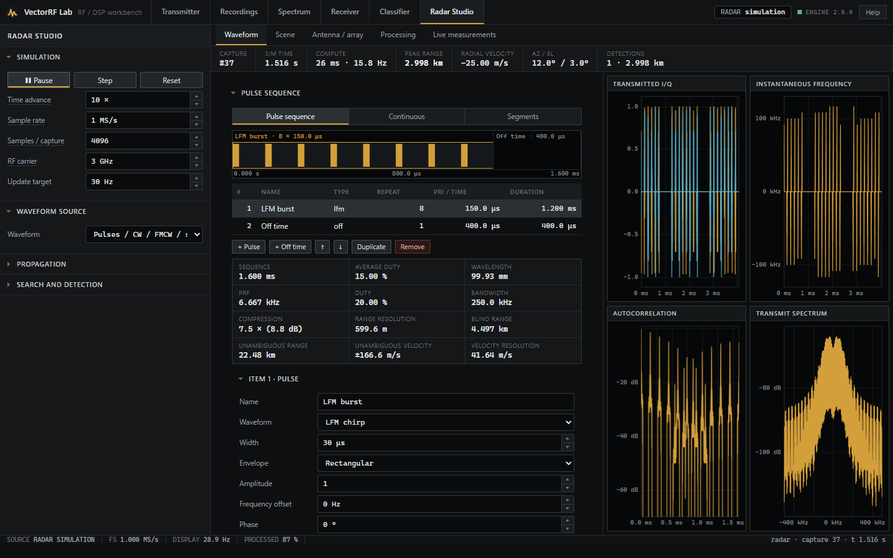</td>
  </tr>
</table>

## What it can do

### Signal generation

| Family | Signals |
| --- | --- |
| Fundamentals | Tone, multitone, AWGN, chirp, custom complex waveform |
| PSK / QAM / APSK | BPSK, QPSK, DBPSK, DQPSK, π/4-DQPSK, OQPSK, 8-PSK, 16-QAM, 64-QAM, 16-APSK, 32-APSK |
| FSK / continuous phase | 2-FSK, 4-FSK, MSK, GMSK |
| Multicarrier | OFDM with an editable resource grid |
| Analog | AM, FM, PM, SSB, DSB-SC |
| Radar | CW, pulse, LFM, NLFM, Barker, Frank, P1–P4, Zadoff-Chu, custom phase codes, Costas, stepped frequency, PMCW, FMCW, arbitrary segments |
| Composite | Up to 16 of the above, each with its own power, offset, phase, data, bursts and hopping |

Data comes from text, bit patterns or PN sequences (PN7, PN9, PN11, PN15), optionally framed; impairments add noise, I/Q imbalance and DC offset. Custom waveforms are written as expressions, frequency/amplitude/phase control points, I/Q tables or trusted local Python extensions. Numeric fields take engineering notation: `2.4G`, `100k`, `20us`, `10mhz`.

**Composites.** Each component's power is calibrated to its own dBm setting — a −20 dBm QPSK integrates to −20 dBm in a channel-power window next to a −10 dBm tone — and the total accounts for components that add coherently. A band plan shows every component's occupied band and refuses anything that would alias.

**Hopping and sweeps.** Any signal, a whole composite or each component can hop over a linear grid, a list or a seeded pseudo-random order, or sweep up, down or up-down, with dwell, off-time, raised-cosine edges and a start delay. The schedule is a 64-bit direct digital synthesizer, so phase is exact at any rate and any simulated time, either continuous (VCO-like) or coherent. [`examples/designs/`](examples/designs) holds ready-made designs, such as QPSK hopping 900 MHz – 1 GHz in 1001 steps.

### I/Q recordings

The **Recordings** workspace keeps a library folder (`VECTORRF_CAPTURES_DIR`) and makes any recording the live source for Spectrum, Receiver, Classifier and Radar Studio:

| Container | Formats |
| --- | --- |
| Raw interleaved (`.iq .bin .dat .raw .cf32 .cfile .cs16 .cs8 .cu8`) | cf32, cf64, ci32, ci24, ci16, ci8, cu8 (RTL-SDR), either endianness, complex or real |
| WAV / RF64 | 2-channel I/Q or mono real; PCM 8/16/24/32-bit, float 32/64; SDR# `auxi` centre frequency |
| SigMF | `.sigmf-meta` + `.sigmf-data` pairs and `.sigmf` archives |

Files are memory-mapped, so multi-gigabyte recordings open instantly. A whole-file overview (spectrogram, power strip, average spectrum) lets you seek and mark a region; headerless files are checked by content heuristics, and rate and centre are read from gqrx and SDR# file names. Playback is contiguous, real time or stepped, with looping. Exports to SigMF carry the power calibration and the transmitter design that made them.

### Spectrum analyzer

Set **centre and span** like a swept analyzer: spans up to a quarter of the sample rate are digitally down-converted (multistage Kaiser decimation), so a narrow span reaches the RBW the capture length allows. RBW is the window's equivalent noise bandwidth, the default window is Blackman-Harris, and every FFT is zero-padded four times so a tone reads its level within 0.1 dB wherever it falls. Levels are simulated dBm or recording dBFS.

Click to place a marker, drag to select a band and zoom to it, measure its channel power, classify it or receive it; scroll to zoom and double-click for full span. Up to eight markers (normal, delta, noise density), eight draggable channel windows (power, density, 99 % bandwidth), four traces with hold and averaging, memories and a waterfall complete it. **Zero span** shows I/Q, envelope, phase and frequency over time. **Modulation quality** measures decision-directed EVM and MER over the most recent 2,048 symbols while tracking the carrier from capture to capture.

### Receiver

Matched filtering, Mueller & Müller or Gardner timing recovery and a carrier loop whose damping, natural frequency, lock range and settling time are shown. **Coarse CFO** acquires offsets up to about ±10 % of the symbol rate for every format (PSK, QAM, APSK, differential); blind phase search resolves QAM. Between captures the receiver keeps tracking instead of acquiring again, and the CMA equalizer keeps its taps; its taps are plotted next to the channel estimated from the known transmitted symbols.

By default the receiver **follows the transmitter**, including the chosen component of a composite and the removal of a known hop schedule. A channel experiment adds noise, frequency and phase offset, fractional delay, an echo and I/Q imbalance. The processing chain inserts gain, frequency translation, FIR and low-pass filters, resampling, DC removal, AGC, expressions, loop blocks and Python extensions, with a probe after any block. Frames built from blocks with their own modulation, rate and role are found by preamble correlation and decoded block by block; OFDM has cyclic-prefix acquisition, pilot channel estimation and blind phase tracking for pilotless QPSK.

### Classifier

The classifier observes one emitter: drag across it in the spectrum and it is mixed to 0 Hz, decimated and filtered before features are measured. The **decision path** lists every rule in order — noise, OFDM, pulsed radar, chirp/FMCW, tone, line spectrum, constant envelope (FSK/MSK/FM), linear modulation — with the measured feature, threshold and outcome. Scores are heuristic agreement, not calibrated probabilities.

### Radar Studio

Design a pulse sequence (or use a recording or an OFDM design as the waveform) and read its PRF, duty, compression, range and velocity resolution and ambiguities. The scene is an interactive top view with up to 12 targets — drag them and their velocity vectors — seen by an array of up to 32 elements with conventional or MVDR beamforming, under a relative R⁻⁴ or a radar-equation link model. Processing is full-waveform delay/Doppler correlation, pulse-Doppler or FMCW dechirp, with MTI clutter cancellation and an editable chain. Detection runs **CA-, GO-, SO- or OS-CFAR** along range in every Doppler row, each solved exactly for the requested false-alarm probability, or a fixed threshold; each cluster of cells above threshold is one detection with range, velocity and margin.

## What it does not do

- Drive radio hardware (RTL-SDR, USRP, HackRF, PlutoSDR, …): record with your SDR's tools and open the file here.
- Process multi-GS/s streams in real time: each update analyses one bounded capture, and real-time pacing skips the rest.
- Electromagnetic or antenna simulation, mutual coupling, terrain or calibrated multipath.
- Conformance testing of named standards (cellular, Wi-Fi, broadcast), MIMO OFDM or unknown-boundary OFDM synchronization.
- Blind hop-pattern discovery or production-grade modulation recognition.
- Radar tracking or calibrated end-to-end false-alarm rates.
- Authentication or TLS: it is a local application.

The models behind every measurement, and their assumptions, are in [DSP notes](docs/DSP_NOTES.md). In short: everything is discrete complex baseband; radar targets are narrowband far-field points moving stop-and-hop within a capture; decision-directed EVM is a laboratory metric. Sample rates reach 5 GS/s, and captures are bounded by sample count (8,388,608 by default, `VECTORRF_MAX_CAPTURE_SAMPLES`), so a higher rate means a shorter capture rather than more memory.

## Python API

The DSP is a plain Python package; the web application is one client of it.

```python
from vectorrf.models import TxConfig, RxConfig
from vectorrf.signal import generate
from vectorrf.rx import demodulate

tx = TxConfig(waveform="qpsk", sample_rate=1e6, symbol_rate=50e3, duration=0.02,
              data_source="pn", pn_order=15, pn_bits=32767, snr_db=30)
capture = generate(tx)
result = demodulate(capture.samples, RxConfig(modulation="qpsk", sample_rate=1e6, symbol_rate=50e3))
print(result.metrics["evm_rms_percent"])
```

The [programming guide](docs/PROGRAMMING.md) covers the Python and HTTP APIs, design files, the live stream, recordings, radar experiments, expressions and extensions.

## Performance

Live views target 30 updates per second with acknowledged backpressure. With real-time pacing (the default) the stream follows the wall clock and drops what it cannot process, so it stays live at any rate: with the default signal the spectrum, zero span and live monitor hold 30 updates/s from 1 MS/s to 2 GS/s, and demodulation and modulation quality hold 28–30 up to 100 MS/s. The receiver decimates to 16 samples per symbol first, so its cost follows the number of symbols rather than the sample rate. [Benchmarks](docs/BENCHMARK.md) has the measurements and their conditions.

## Project layout

```text
vectorrf-lab/
├── backend/vectorrf/      Python package: DSP, models, live engine, HTTP API
│   └── web/               the browser application (ES modules, no build step) and the user guide
├── tests/                 pytest suite, browser unit tests (js/) and an end-to-end browser test (ui/)
├── examples/              benchmark script and example transmitter designs
├── extensions/            example Python extensions (a waveform and a receiver block)
├── scripts/               maintenance scripts (screenshots)
├── docs/                  architecture, DSP notes, programming guide, testing, benchmarks, references
├── start.sh, start.bat    one-command launchers
└── pyproject.toml         packaging and test configuration
```

## Development

```bash
python -m pip install -e '.[dev]'
python -m pytest
```

The suite of about 1,200 tests checks the mathematics against analytic results (window ENBW, RRC Nyquist, radar code sidelobes, CFAR false-alarm rates, exact DDS phase), the receiver across formats, offsets and rates, recordings round trips, the API under malformed input, the live stream's pacing and the packaged wheel. [Testing](docs/TESTING.md) describes it, along with the end-to-end browser test and the release checks. [CONTRIBUTING.md](CONTRIBUTING.md) explains how to propose changes; DSP changes come with a regression test and a note of their assumptions.

## Security

The launchers bind to `127.0.0.1`, and the live WebSocket accepts only same-origin pages. Do not expose the server to an untrusted network without authentication and TLS in front of it. Python extensions are executable code: load only those you trust. The recording API reads, writes and deletes files only inside the library folder. See [SECURITY.md](SECURITY.md).

## Documentation

- [Architecture](docs/ARCHITECTURE.md) — how the stream, engine, instruments and browser fit together
- [DSP notes](docs/DSP_NOTES.md) — the models, estimators and their assumptions
- [Programming guide](docs/PROGRAMMING.md) — Python and HTTP APIs, design files, extensions
- [Testing](docs/TESTING.md) and [Benchmarks](docs/BENCHMARK.md)
- [References](docs/REFERENCES.md) — the literature behind the algorithms
- [Changelog](CHANGELOG.md)

## Acknowledgements

VectorRF Lab was inspired by the SDR Lab idea and demo that **Ahmad ALJesirawi** shared [on LinkedIn](https://lnkd.in/p/eF25h9At). This is an independent project with its own implementation, features and limitations.

## License

[MIT](LICENSE)
