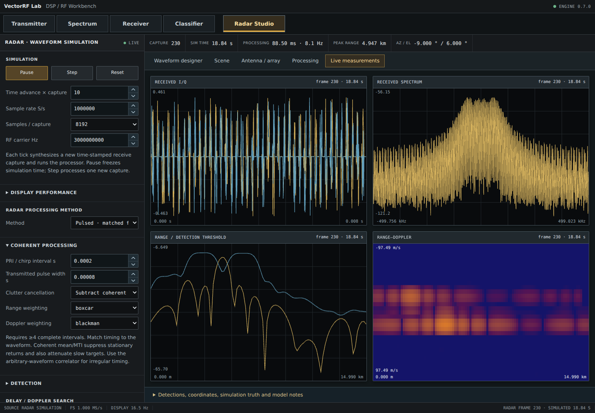
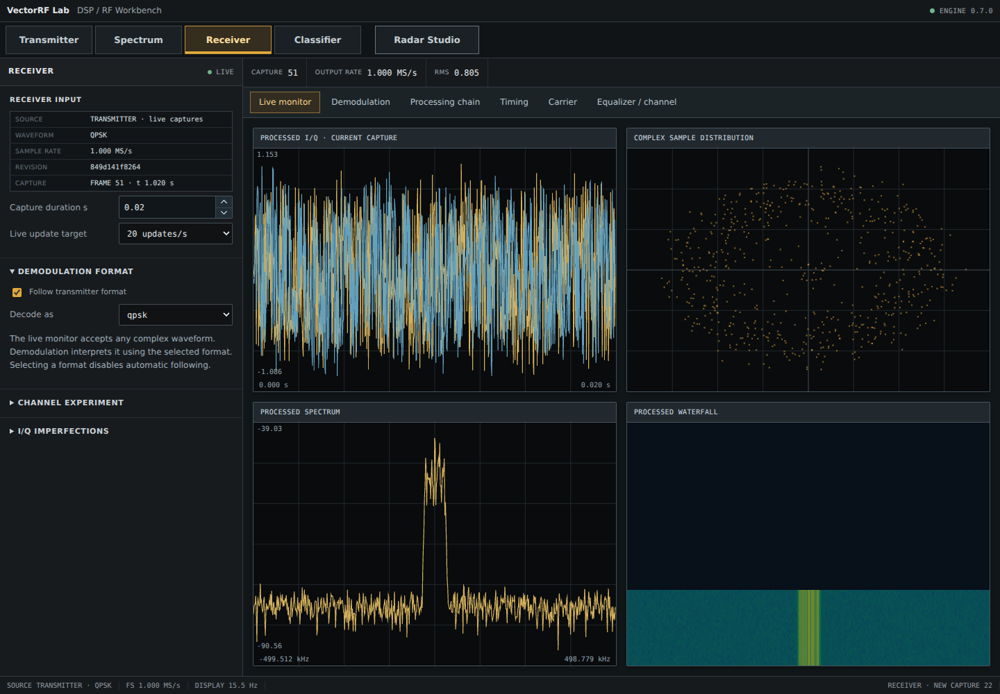
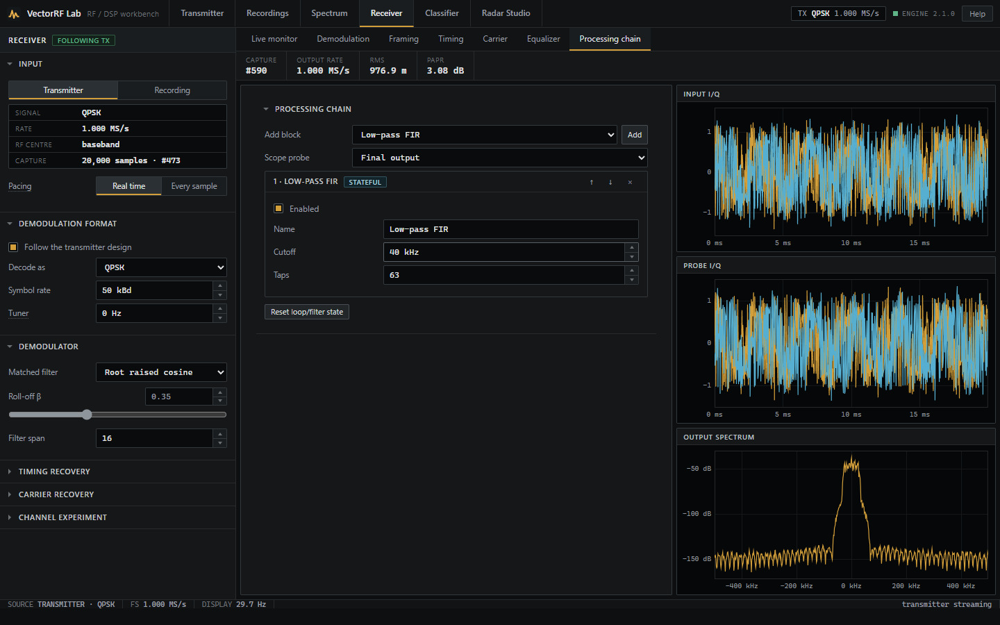
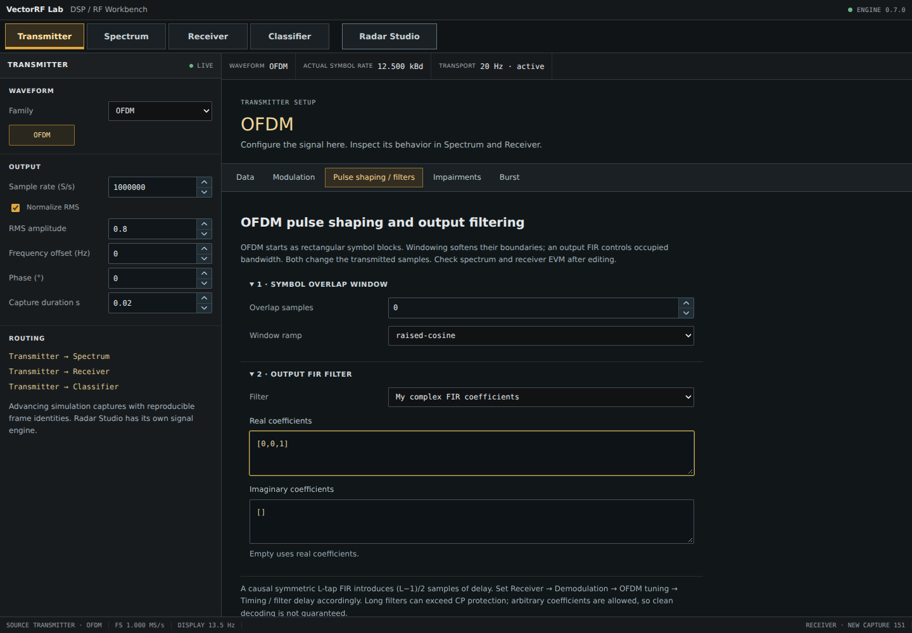
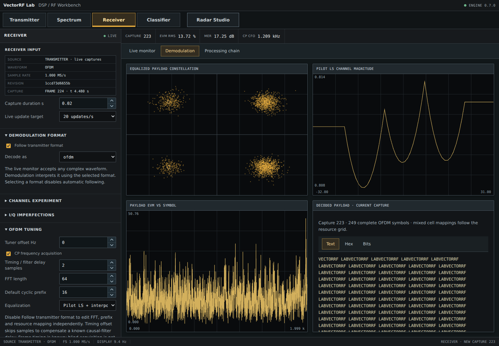
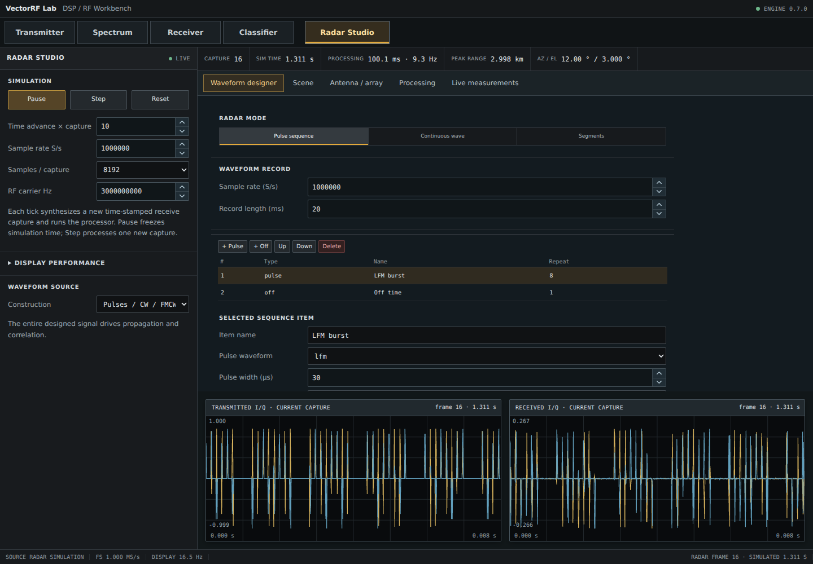
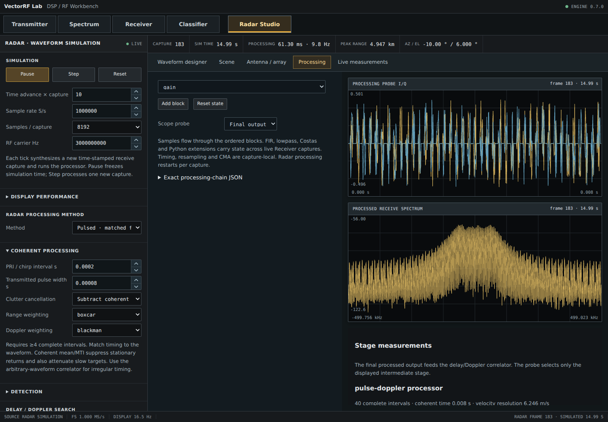

# VectorRF Lab

**VectorRF Lab** is a local, browser-based software-defined radio (SDR), DSP, and radar experimentation studio written in Python. It generates complex baseband signals, visualizes them as virtual instruments, runs receiver and framing workflows, and simulates configurable radar scenes — all without requiring RF hardware.

The project is intended for learning, prototyping, algorithm experiments, and RF/DSP exploration. It is **not** a calibrated RF instrument, standards-conformance tool, hardware SDR driver, or full-wave electromagnetic simulator.



## Highlights

- Local web UI backed by FastAPI and NumPy/SciPy DSP.
- Signal generation for fundamentals, analog modulation, PSK/QAM/APSK, FSK/MSK/GMSK, OFDM, custom mathematical waveforms, and multiple radar waveforms.
- Live time-domain, I/Q, spectrum, waterfall, zero-span, constellation, receiver, and radar views.
- Editable receiver DSP chain with filtering, tuning, resampling, AGC, synchronization/equalization blocks, expressions, and local Python extensions.
- Generic communications framing with preamble/payload blocks, CRC support, acquisition, and per-block decoding.
- Configurable OFDM resource grid, pilots, cyclic prefix, overlap/windowing, filtering, and receiver tuning.
- Radar waveform/scene/array laboratory with point targets, motion, beamforming, range/Doppler processing, clutter rejection, and detection controls.
- Deterministic local capture model for repeatable tests and experiments.
- Installable CLI plus one-command start scripts for Windows and Linux/macOS.
- MIT licensed.

## Interface tour

A few of the major workspaces and feature views:

<table>
  <tr>
    <td width="50%"><strong>Receiver · live monitor</strong><br></td>
    <td width="50%"><strong>Receiver · processing chain</strong><br></td>
  </tr>
  <tr>
    <td width="50%"><strong>Receiver · demodulation</strong><br></td>
    <td width="50%"><strong>OFDM · transmitter shaping</strong><br></td>
  </tr>
  <tr>
    <td width="50%"><strong>OFDM · receiver tuning</strong><br></td>
    <td width="50%"><strong>Radar · waveform designer</strong><br></td>
  </tr>
</table>

## Quick start

### Windows

```bat
start.bat
```

### Linux / macOS

```bash
bash start.sh
```

On first launch, the script creates `.venv` and installs the Python dependencies. Then open:

**http://127.0.0.1:8765**

The application binds to localhost by default. Set `VECTORRF_PORT` to change the port.

### Manual install

```bash
python -m venv .venv
# Windows: .venv\Scripts\activate
# Linux/macOS: source .venv/bin/activate
python -m pip install -e .
vectorrf-lab
```

You can also start the server directly:

```bash
python -m uvicorn vectorrf.app:app --app-dir backend --host 127.0.0.1 --port 8765
```

## What it can do

### Signal generation

VectorRF Lab supports:

| Family | Built-in signals |
| --- | --- |
| Fundamentals | Custom complex waveform, tone, multitone, AWGN, chirp |
| PSK / QAM / APSK | BPSK, QPSK, DBPSK, DQPSK, π/4-DQPSK, OQPSK, 8-PSK, 16-QAM, 64-QAM, 16-APSK, 32-APSK |
| FSK / continuous phase | 2-FSK, 4-FSK, MSK, GMSK |
| Multicarrier | OFDM |
| Analog | AM, FM, PM, SSB, DSB-SC |
| Radar | CW, pulse, LFM, NLFM, Barker, Frank, P1/P2/P3/P4, Zadoff-Chu, custom phase code, Costas, stepped-frequency, PMCW, FMCW, arbitrary radar waveform |

Custom waveform construction supports mathematical expressions, frequency/amplitude/phase control points, explicit I/Q tables, and trusted local Python extension modules.

### Spectrum and virtual instruments

The spectrum workspace provides FFT-based spectrum analysis, configurable RBW/windowing/averaging, absolute simulated dBm calibration, four traces, max/min hold, exponential averaging, markers/delta markers, zoom/pan, capture memories, waterfall, zero-span AM/PM/FM views, and modulation-quality views where meaningful.

Requested spectrum span is fixed around complex-baseband DC and supports up to 10 MHz. If the selected source sample rate is narrower than the requested span, the UI marks the region outside source Nyquist instead of inventing data.

### Receiver laboratory

The receiver includes a general I/Q/spectrum/waterfall monitor and a separate demodulation workspace. The processing chain can insert:

- gain and frequency translation;
- complex FIR and low-pass filtering;
- rational resampling;
- DC removal and RMS AGC;
- complex mathematical expressions;
- Costas, Gardner, Mueller & Müller, and CMA blocks;
- trusted local Python processing extensions.

Built-in demodulation covers the supported communications/basic families listed in the source model. The linear-modulation bench exposes timing, carrier, and equalizer controls.

### Framing and decoding

The transmitter can build generic frames from ordered blocks with independent digital modulation, symbol rate, bit length, relative power, and role. Receiver framing performs energy detection, normalized preamble correlation, and block-by-block decoding using the same frame plan.

This is a generic laboratory frame builder; it is not an implementation of a named cellular, Wi-Fi, satellite, or broadcast standard.

### OFDM laboratory

OFDM experiments can configure FFT size, occupied carriers, guard carriers, DC, cyclic prefix, frame symbols, pilots, per-cell overrides, data modulation, overlap/windowing, and post-OFDM FIR filtering. The receiver includes CP-based coarse frequency acquisition, pilot least-squares channel interpolation, constellation/EVM displays, and decoded text/hex/bits.

Known limitation: frame-boundary discovery and MIMO OFDM/resource ports are not implemented.

### Radar studio

Radar Studio includes waveform design, scene definition, array geometry, processing, and live measurement views. It supports up to 12 point targets and up to 32 receive elements, target position/velocity/acceleration/RCS controls, Swerling-I amplitude fluctuation, conventional or diagonally loaded MVDR beamforming, relative R⁻⁴ or monostatic radar-equation link models, and editable processing before range/Doppler estimation.

Processing modes include full-waveform delay/Doppler correlation, coherent pulsed processing with matched filtering + Doppler FFT, and FMCW dechirp + range/Doppler FFT. Clutter suppression, weighting, range gates, CA-CFAR/manual thresholds, array pattern, angle response, and scene geometry views are available.



## What it does **not** do

To keep the project scope clear, the current release does **not** provide:

- direct RTL-SDR, USRP, HackRF, LimeSDR, PlutoSDR, or other radio-hardware drivers;
- live RF capture from physical hardware;
- microphone/audio recording or WAV/IQ file import/export workflows;
- a full-wave EM/antenna solver, mutual-coupling model, mesh scattering, terrain propagation, or calibrated multipath model;
- named wireless-standard conformance testing or certification;
- MIMO OFDM, robust unknown-boundary OFDM synchronization, or reference-aligned standards BER/EVM;
- production-grade blind modulation recognition guarantees — classifier scores are heuristic;
- radar tracking/data association or calibrated end-to-end false-alarm probability;
- persistent project save/load, undo/redo, or parameter-sweep experiment management;
- authentication/TLS for exposing the web server to untrusted networks.

See [the roadmap](docs/ROADMAP.md) for known future engineering work and [DSP notes](docs/DSP_NOTES.md) for model assumptions.

## Important modeling limits

VectorRF Lab is a **discrete complex-baseband simulator**. Radar uses narrowband far-field point-target assumptions and a stop-and-hop approximation within a capture. A linear array does not uniquely resolve elevation. Periodic waveforms can produce real ambiguity peaks. Decision-directed EVM is a laboratory metric, not a standards-conformance result.

Communications captures are bounded at two million samples. Radar input is bounded at 32,768 samples, radar processed output at 65,536 samples, processing chains at 24 blocks, receive arrays at 32 elements, and scenes at 12 targets.

## Extensions

Trusted local Python modules in `extensions/` can add waveform and processing algorithms. The application loads extension modules as executable Python code, so only use extensions you trust.

See [docs/PROGRAMMING.md](docs/PROGRAMMING.md) for the waveform, expression, OFDM-grid, and receiver extension interfaces.

## Project layout

```text
vectorrf-lab/
├── backend/vectorrf/        # Python package and packaged browser UI
│   └── web/                 # HTML/CSS/JavaScript served by FastAPI
├── tests/                   # Backend/API/DSP regression tests
│   └── ui/                  # Deterministic and live browser smoke tests
├── extensions/              # Example local Python extensions
├── examples/                # Benchmarks / examples
├── docs/                    # Architecture, DSP notes, research, roadmap, screenshots
├── .github/                 # CI and contribution templates
├── pyproject.toml           # Packaging and test configuration
├── start.sh / start.bat     # Plug-and-play local launchers
└── LICENSE                  # MIT
```

The `backend/` package layout is intentional: it keeps importable application code separate from repository tooling and documentation while preserving the existing runtime layout.

## Tests

Install development dependencies and run the regression suite:

```bash
python -m pip install -e '.[dev]'
python -m pytest
```

The current suite covers signal generation, spectrum behavior/calibration, receiver workflows, framing, OFDM, radar processing, programmable expressions/extensions, API validation, WebSocket streaming/backpressure, and release regressions.

For the deterministic browser smoke test:

```bash
python -m pip install -e '.[ui-test]'
python -m playwright install chromium
python tests/ui/ui_smoke.py
```

For the optional live-server browser smoke test, run `npm install`, start VectorRF Lab, then run `npm run test:ui:live`.

See [docs/RELEASE_TESTING.md](docs/RELEASE_TESTING.md) for the complete release gate.

## Performance

Live spectrum/receiver display targets 30 updates/s with acknowledged backpressure; radar also targets 30 Hz with the default capture size. Achieved rates depend on CPU, browser, FFT settings, sample rate, capture size, and processing chain. Display reduction never changes the sample rate used for DSP calculations.

Historical local benchmark numbers and their exact test conditions are in [docs/BENCHMARK.md](docs/BENCHMARK.md). They are not hardware guarantees.

## Security

The default launchers bind to `127.0.0.1`. Do not expose VectorRF Lab directly to an untrusted network without adding authentication, TLS, and appropriate network controls. Python extensions are executable code.

See [SECURITY.md](SECURITY.md).

## Documentation

- [Architecture](docs/ARCHITECTURE.md)
- [Programming / extension guide](docs/PROGRAMMING.md)
- [DSP notes and assumptions](docs/DSP_NOTES.md)
- [Research references](docs/RESEARCH.md)
- [Benchmarks](docs/BENCHMARK.md)
- [Release testing](docs/RELEASE_TESTING.md)
- [Repository cleanup validation](docs/REPOSITORY_VALIDATION.md)
- [Roadmap](docs/ROADMAP.md)
- In-app **Help** page at `/help`

## Contributing

Issues and pull requests are welcome. Please read [CONTRIBUTING.md](CONTRIBUTING.md) before making changes, especially the rule that numerical/DSP behavior changes should include focused regression tests and documented assumptions.

## Inspiration

VectorRF Lab was inspired by the idea and public demo shared by **Ahmad ALJesirawi** in his SDR Lab LinkedIn post:

https://lnkd.in/p/eF25h9At

This repository is an independent Python/FastAPI project with its own implementation, feature set, and limitations; it does not claim feature parity with the referenced project.

## License

VectorRF Lab is released under the [MIT License](LICENSE).
